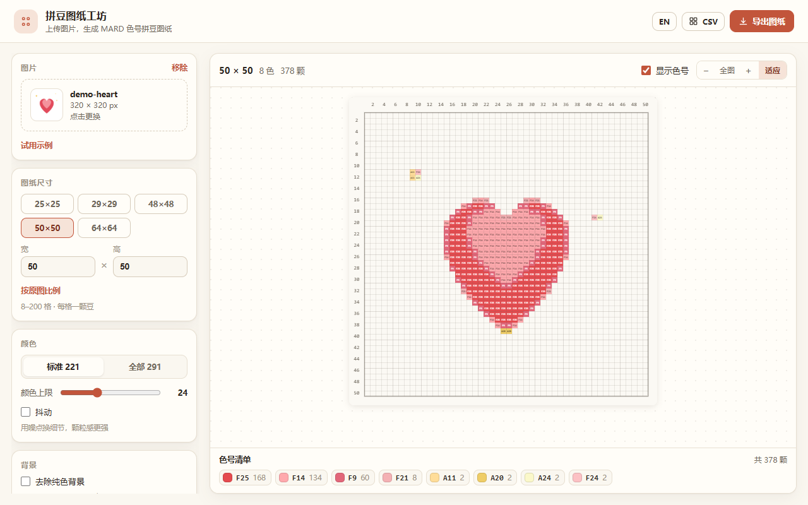
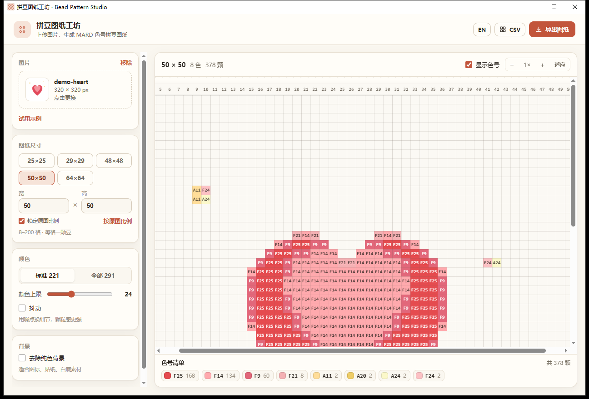

# 拼豆图纸工坊 · Bead Pattern Studio

上传任意图片，生成 **MARD 色号** 的拼豆图纸。尺寸（格子数）自由设定，支持导出可打印的图纸 PNG 与色号清单 CSV。

同一套渲染与算法提供三种形态：

| 形态 | 入口 | 适用场景 |
| --- | --- | --- |
| DeepSeek Harness 插件 | 侧边栏「拼豆图纸工坊」 | 在 Harness 里边聊边出图 |
| 单文件网页 | `web/index.html`（双击即可） | 手机、平板、任何浏览器 |
| Windows 桌面版 | `build/BeadPatternStudio.exe` | 不装环境，双击就用 |


## 功能

- **图片转图纸**：PNG / JPG / WebP，点击选择、拖拽到画布，或直接 Ctrl+V 粘贴剪贴板图片。
- **尺寸自定义**：25×25、29×29、48×48、50×50、64×64 预设，也可手填 8–200 之间的宽高；默认锁定原图比例（改一维联动另一维），取消锁定后自由尺寸按居中裁切取景，任何比例都不拉伸。
- **MARD 官方色号**：内置 291 色完整色卡（标准 221 色 + 扩展 P/Q/R/T/Y/ZG 70 色），可切换「标准 221」或「全部 291」。
- **颜色数量可控**：Lab 空间 k-means 聚类 + 最近色映射，颜色上限 2–64（默认 24），保证成品不会出现几十种难买的色号。
- **抖动（可选）**：Floyd–Steinberg 蛇形误差扩散，用颗粒感换细节，适合人像与渐变。
- **去纯色背景（可选）**：自动检测图片边框是否为纯色，是则抠成空格；容差可调（ΔE 0–60）。
- **画布预览**：每一格都标注对应色号（默认开启，可关）、行列编号、5 格加粗网格、按底色自动反色、缩放 1×/2×/3×；为保证色号看得清，格子不小于 20px，宽图可横向滚动并自动居中。
- **导出图纸 PNG**：标题 + 尺寸/色数/总颗数 + 四边行列编号 + 格内色号 + 色卡图例（色号 + 颗数，**一排最多 10 个**）+ 页脚，长边最高 4100px，字号按图纸尺寸放大到清晰可读。
- **导出色号清单 CSV**：`code,hex,count` + `TOTAL` 行，带 UTF-8 BOM，Excel 直接打开不乱码。
- **文件名统一前缀**：导出文件名为 `pindou-<原图名>-<宽>x<高>-mard.png` / `.csv`，一眼能认出是拼豆图纸。
- 中英双语界面，一键切换；亮/暗主题自适应；设置自动记住，可一键恢复默认。

## 网页版

```bash
node build-web.mjs          # 产出 web/index.html（约 96 KB，单文件）
```

- `web/index.html` 自带全部 CSS / JS / 291 色色卡，**双击就能用**，也可以直接丢到任意静态托管（GitHub Pages、Netlify、对象存储、内网 nginx）。
- 所有处理都在浏览器本地完成，不上传图片、不请求后端；静态托管只需要托管这一个文件。
- 打开后：选图 → 调尺寸/颜色 → 「导出图纸」下载 PNG，「CSV」导出色号清单。手机浏览器同样能用。



## Windows 桌面版

```powershell
powershell -NoProfile -ExecutionPolicy Bypass -File win\build-exe.ps1
```

- 产物：`build/BeadPatternStudio.exe`，**单文件约 900 KB**，内置网页与 WebView2 SDK 程序集，不需要 Node、不需要另外安装依赖。
- 运行要求：Windows 10/11（自带 WebView2 运行时；若缺失会提示并可用系统浏览器打开）。
- 首次启动会把 `index.html` 解到 `%LOCALAPPDATA%\BeadPatternStudio\`（WebView2 需要真实文件路径），设置留在同目录。
- 导出时弹出系统「另存为」文件对话框，自己选目录与文件名，默认落在 `Downloads`；CSV 与 PNG 都是本地生成。



## 安装（DSH 插件）

从 npm 安装（发布后可用，装完出现在「插件中心」）：

```bash
dsh plugin --profile web add dsh-pindou-pattern
```

或直接源码安装这个仓库：

```bash
dsh plugin --profile web add github:nanhaiya/dsh-pindou-pattern
```

本地开发时也可以直接安装目录：

```bash
dsh plugin add E:\workspace\pindou   # 或在 Harness 的插件面板里安装该目录
```

安装后侧边栏「全局面板」会出现「拼豆图纸工坊」入口（排在「智能体」之后），点击即可打开工作台。

## 使用

1. 上传图片（选择 / 拖拽 / Ctrl+V）。
2. 选尺寸：默认「锁定原图比例」——上传后按原图比例自动算出格子数（例如 2:1 的图就是 25×13），改宽或高会联动另一维，点预设也按比例算，不会把图压扁或拉长。
   想自己定尺寸就取消勾选，填任意宽高；此时画面按**居中裁切**取景（cover），同样不会变形。
3. 调颜色：切换色号范围、拖动「颜色上限」、按需打开抖动或去背景。
4. 右上角「导出图纸」预览并下载 PNG；「CSV」导出色号清单。

每格显示的就是 MARD 色号，图例给出每种色号的颗数，按颗数排序。

## 算法

```
图片 → 逐级减半降采样 → W×H 网格像素
     → （可选）纯色背景判定 → 空格
     → Lab 空间 k-means（k = 颜色上限，固定种子，可复现）
     → 质心映射到最近的 MARD 色号（限定标准/全部）
     → 逐格最近色（或 Floyd–Steinberg 抖动）
     → cells + 色号统计 → Canvas 预览 / 图纸 PNG / CSV
```

- 颜色距离使用 CIELAB ΔE（D65）。
- 背景判定：取图片四边像素的中位色，只有当边框上 ≥55% 的像素落在该色 ΔE≤10 内时才认为是纯色背景（照片不会被误判）。
- 训练集上限 12000 点，200×200 网格 + 64 色 + 抖动约 80–160ms。

## 兼容性

- DSH 版本：`>= 0.2.1-rc.3`（`dsh.engines.dsh`）
- 平台：Web（浏览器端 Canvas 渲染，无 Host 服务）
- 运行环境：Node.js >= 20.3（仅构建需要）
- 浏览器：支持 Canvas 2D 的现代浏览器（Chrome / Edge / Safari 16+ / Firefox）
- 桌面版：Windows 10/11 x64 + WebView2 运行时

## 权限与隐私

- 图片**只在本地处理**：不上传、不发网络请求，导出文件由本地 Canvas 生成。
- 不申请任何 DSH 工具、文件系统或凭据权限；Host 半只有空 `apply()`。
- 设置存在浏览器 `localStorage`（桌面版是 WebView2 的本地存储），可随时「恢复默认设置」清除。

## 开发

```bash
node build.mjs              # src/palette.json + engine + shared + ui → client.js
node build-web.mjs          # 同样的代码 → web/index.html（单文件）
node test/engine.test.cjs   # 13 组引擎断言（色卡、聚类、抖动、去背、性能）
powershell -File win\build-exe.ps1   # 内嵌 web/index.html → build/BeadPatternStudio.exe
```

- `src/palette.json`：291 个 MARD 色号 `{code, hex, series}`。
- `src/engine.js`：纯逻辑（采样、聚类、映射、抖动、背景判定），无 DOM 依赖。
- `src/shared.js`：渲染层（`drawPattern`、`renderSheet`、CSV、示例图、i18n 文案、CSS），插件与网页共用。
- `src/ui.js`：DSH 面板注册与 React 工作台，包在 `shared` 外面。
- `src/webui.js`：网页版的 vanilla DOM 界面，同样复用 `shared`。
- `win/Program.cs`：WinForms + WebView2 外壳，把 `web/index.html` 与 SDK 程序集内嵌进 exe。

色卡数据整理自 [pixel-beads.com 的 MARD 色号表](https://www.pixel-beads.com/zh/mard-bead-color-chart)（291 色 / 标准 221 / 扩展 70）。

## 结构

```
package.json          # dsh.bundle.patch + dsh.client 声明
cordis.patch.yml      # 插入 pindou-pattern 条目
index.js              # Host 半（无需服务，空实现）
client.js             # 构建产物：Harness 面板
src/
  palette.json        # 291 色 MARD 色卡
  engine.js           # 纯算法
  shared.js           # 共用渲染 / 导出 / 文案
  ui.js               # Harness UI（React）
  webui.js            # 网页 UI（vanilla）
build.mjs             # → client.js
build-web.mjs         # → web/index.html
web/index.html        # 单文件网页版
win/Program.cs        # Windows 外壳
win/build-exe.ps1     # → build/BeadPatternStudio.exe
win/icon.ico          # 应用图标
locale/{zh,en}.json   # 插件元信息文案
icon.svg              # 侧栏图标
docs/                 # 截图
```

## 许可

MIT
